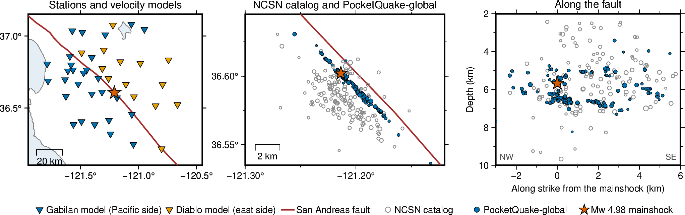

# PocketQuake-global



*The benchmark: the November 2026 Pinnacles sequence (Mw 4.98, creeping section of the San Andreas
fault). Left: the 42 stations, by the model HYPOINVERSE uses for them, following NCSN: Gabilan for the
Pacific side, Diablo east of the fault. Middle and right: NCSN's catalog (open grey) and
PocketQuake-global's cross-correlation relocation (blue).*

From an earthquake catalog anywhere to relocated hypocenters, focal mechanisms and a summary
notebook. It runs the same chain as [PocketQuake](https://github.com/seismoseo/PocketQuake)
(PhaseNet+ picking → HYPOINVERSE → HypoDD with catalog and cross-correlation data → SKHASH →
results notebook and PDF report), but takes the stations, picks and waveforms from FDSN data
centres through ObsPy instead of the Korean KMA portal. It needs no NECIS account and no browser
automation.

```
USGS ComCat catalog (UTC)
  → the seismic network's own picks for those events        FDSN event service (e.g. NCEDC)
  → the stations it picked, within a radius, that have a
    three-component sensor recording at >= 100 samples/s    FDSN station service
  → event waveforms, origin -240 s .. +360 s, rotated Z/N/E  FDSN dataselect
  → PocketQuake's orchestrator and relocation pipeline
```

PocketQuake (v1.18.0 or later) is a submodule, `external/PocketQuake`, and brings its pipeline
(`korea-cluster-relocation`) with it. PocketQuake-global only adds the FDSN stages and the
global settings.

**Status (v0.3.0).** Benchmark: the 176 events of the November 2026 Pinnacles sequence, end to
end ([Benchmark](#benchmark-the-2026-pinnacles-sequence)). Also validated on the 30 largest
events of the 2015 San Ramon swarm ([Validation](#validation-san-ramon-2015)).

## Install

```bash
git clone --recurse-submodules --shallow-submodules https://github.com/seismoseo/PocketQuake-global
cd PocketQuake-global
```

1. **Environment.** Use PocketQuake's environment (`external/PocketQuake/environment.yml`). It
   provides ObsPy, the PhaseNet+ picker (EQNet, PyTorch) and the notebook tools. For GPU
   cross-correlation, PyTorch must support your card (e.g. a cu128 build for RTX Blackwell);
   without a usable GPU the CPU path runs and gives the same results, more slowly.
2. **External tools.** HYPOINVERSE, HypoDD (with ph2dt and ncsn2pha), SKHASH and EQNet, exactly
   as for PocketQuake: `external/PocketQuake/docs/EXTERNAL_TOOLS.md`.
3. **Tool paths.** Copy `.env.example` to `.env` and fill in `EQNET_DIR`, `SKHASH_DIR` and,
   optionally, `HELVETICA_DIR`. No data-centre credentials are needed.
4. Optionally `pip install -e .` for a `pocketquake-global` command; otherwise run
   `python -m pqglobal.run` from the repository.

On a GPU shared with other jobs, limit the cross-correlation's GPU memory, e.g.
`XCORR_VRAM_FRACTION=0.1 XCORR_VRAM_CAP=0.15` (batches up to 10 % of the free memory, the process up
to 15 % of the card; the differential times do not depend on it). The benchmark figure needs PyGMT.

`pytest -q tests` runs the offline tests (no network, no seismic tools).

## Benchmark: the 2026 Pinnacles sequence

The 176 USGS ComCat events within 15 km of the Mw 4.98 mainshock of 20 November 2026
(nc75468702), 1–28 November 2026, on the creeping section of the San Andreas fault near Pinnacles,
California. NCEDC picks, stations and waveforms; NCSN's own Bear Valley velocity setup (two models
across the fault); pairs with an event of M ≥ 2 cross-correlated on the onset.

```bash
./examples/pinnacles2026.sh                # dry run: catalog, NCSN picks, the 42 stations, plan
./examples/pinnacles2026.sh apply          # download (~35 min) and the whole chain
python examples/pinnacles2026/check.py     # the numbers below, beside the reference values
python examples/pinnacles2026/figure.py    # the figure above (PyGMT)
```

The inputs are in [`examples/pinnacles2026/`](examples/pinnacles2026/README.md): the ComCat export as
of 27 November (kept, so the benchmark does not move when ComCat does), and the 10 stations east of the
fault that are newer than NCSN's alternate-model list. NCSN's HYPOINVERSE package is downloaded from
NCEDC and checked.

| | PocketQuake-global v0.3.0 |
|---|---|
| stations | 42 within 60 km (21 accelerometers, 16 broadband, 5 short-period) |
| PhaseNet+ P picks against NCSN's analyst picks | median difference 0.01 s; 94 % within 0.1 s (258 pairs) |
| S picks | median 0.03 s; 91 % within 0.1 s (75 pairs) |
| located | 176 / 176 (HYPOINVERSE, median RMS 0.19 s); 163 (HypoDD dt.ct); 172 (HypoDD dt.cc) |
| focal mechanisms (SKHASH) | 175; 80 of quality A or B; the mainshock 16° (Kagan angle) from the NC moment tensor |
| run time (GPU) | ⟨RUNTIME⟩ |

What the relocation adds, along the line of epicenters within 6 km of the mainshock:

| | NCSN catalog | PocketQuake-global (dt.cc) |
|---|---:|---:|
| scatter across the line (sd) | 1,124 m | 152 m |
| mainshock from the line | 1,964 m north-east | 5 m |
| aftershocks south-east of the mainshock | 83 % | 79 % |
| median distance south-west of the mapped fault trace | 2.16 km | 0.96 km |

The relocated sequence is a sharp line parallel to the fault, with the mainshock on it. NCSN's catalog puts
the mainshock about 2 km north-east of its own aftershock cloud.

**NCSN's alternate list.** NCSN's Bear Valley setup gives the Diablo model to the stations in its
alternate list (east of the fault), last updated for stations installed up to spring 2013. Ten of the
benchmark's stations are east of the fault and newer; `--alternate-extra` adds them. With NCSN's list
alone they get the Pacific-side model: the median HYPOINVERSE RMS is 0.28 s instead of 0.19 s, 62
instead of 80 mechanisms reach quality A or B, and the relocated line lies 0.58 km farther south-west
with the same shape (to 7 m).

## Use

The examples are thin wrappers around `python -m pqglobal.run`. The San Ramon validation:

```bash
./examples/sanramon2015.sh                 # dry run: catalog, network picks, station set, plan
./examples/sanramon2015.sh apply           # + download and run the whole chain
LARGEST=30 ./examples/sanramon2015.sh apply   # the 30 largest events only
```

runs

```bash
python -m pqglobal.run --name sanramon2015 --region SanRamon2015 --work work/sanramon2015 \
    --usgs-box 37.75,37.83,-122.01,-121.91 --start 2015-10-01 --end 2015-12-01 \
    --velmodel con --radius-km 60 --cores 2 [--stop-after stations] [--apply]
```

and the Pinnacles benchmark adds NCSN's two-model setup:

```bash
python -m pqglobal.run --name pinnacles2026 --region Pinnacles2026 --work work/pinnacles2026 \
    --catalog-csv examples/pinnacles2026/comcat_sequence.csv --radius-km 60 --cores 2 \
    --velmodel ncsn:gab --ncsn-multmod work/ncsn_hypoinverse/multmod5a.hyp \
    --alternate-extra examples/pinnacles2026/alternate_extra_newer_stations.txt [--apply]
```

Stages 1–3 (catalog, picks, stations) write into `--work` and are reused on a rerun.
`--stop-after stations` lets you inspect `station_table/sensors.csv`, where every picked sensor in
the radius is listed with why it was used or not, before anything is downloaded. Without
`--apply` the command only prints the cluster it would build. `--largest N` keeps the N largest
events, for a quick test.

Results land where PocketQuake puts them: the cluster source folder and
`pipeline/runs/<name>/` inside `external/PocketQuake/external/korea-cluster-relocation/`, the
notebook in its `pipeline/notebooks/`, and the PDF report in `pipeline/runs/<name>/summary/`.

### S cross-correlation on the transverse component

Add `--s-on-t` to rotate the downloaded N/E traces into R/T and measure S differential times on
T; P stays on Z. Without an orientation table this uses nominal geographic N/E. The default
without these options keeps the existing better-of-N/E S measurement.

For sensors with measured orientation changes, supply an epoch table with
`--orientation-csv PATH` (which also enables `--s-on-t`):

```bash
python -m pqglobal.run --name sanramon2015_t --region SanRamon2015 --work work/sanramon2015 \
    --usgs-box 37.75,37.83,-122.01,-121.91 --start 2015-10-01 --end 2015-12-01 \
    --velmodel con --radius-km 60 --cores 2 \
    --orientation-csv residual_orientation.csv --orientation-missing error \
    --rotation-reference 37.79,-121.96 --apply
```

FDSN waveforms have already been rotated into Z/N/E using each channel's metadata azimuth and
dip, with signed sensitivity removed. The optional table must describe the **residual
misorientation of those exported N/E traces**, in degrees, with the convention
`rotation angle = (back azimuth - misorientation) % 360`. Supplying the original sensor's
metadata azimuth again would apply the same correction twice.

`--orientation-missing error` stops when a table has no matching sensor epoch; `zero` assumes
0 degrees for unmatched epochs, and `skip` omits their R/T traces and S measurements. The
optional `--rotation-reference LAT,LON` uses one shared source point for every back azimuth;
the default uses each event's coordinates. Table schema, interval boundaries, repair options
and provenance are documented in [PocketQuake's orientation manual](external/PocketQuake/docs/orientation.md).
Use a new cluster name when comparing component or orientation settings so the results are
kept separately.

## Rules and settings

| | rule | why |
|---|---|---|
| catalog | USGS ComCat, UTC; of two events in the same UTC second the smaller is dropped (listed in `event_catalog.dropped.csv`) | the pipeline names an event's waveform folder by its origin second |
| stations | the stations the network itself picked for the catalog's events, within `--radius-km` (60) of the catalog centroid, whose picked sensor has three components at >= `--min-sps` (100); one sensor per station, in the order broadband, short-period, borehole, accelerometer | the same station set as the SeisComP San Ramon study; any sensor type; picks come from the FDSN event service of the network: NCEDC for `nc` event ids (tested), SCEDC for `ci` (not yet tested), or `--picks-service` |
| vertical-only sensors | left out | the picker needs three components |
| waveforms | origin -240 s .. +360 s (as PocketQuake's KMA data); each channel divided by its signed sensitivity; rotated to Z/N/E with the metadata's azimuth and dip | correct polarity and orientation for 1/2/3-named, downward-pointing and negative-gain channels |
| S cross-correlation | better of N/E by default; `--s-on-t` selects T, with optional time-dependent residual corrections from `--orientation-csv` | compares the same physical component across sensor orientation changes; P stays on Z |
| velocity model, two across a fault | `--velmodel ncsn:<code>` with `--ncsn-multmod` (NCSN's `multmod5a.hyp` from NCEDC's HYPOINVERSE package): the model `<code>` and its alternate, e.g. `ncsn:gab` (Bear Valley: Gabilan, and Diablo for the stations in NCSN's alternate list), with NCSN's station delays and P-to-S ratios, exactly as NCSN reads them; `--alternate-extra` adds stations to the alternate list. HypoDD uses the slowness average of the two models in at most 20 layers; SKHASH traces takeoff angles through the average and both models | locations follow the network's own model choices; NCSN's alternate list dates from 2013 |
| velocity model | `--velmodel con`: the NCSN Concord-Calaveras gradient model (Northern California) cut into 20 constant-velocity layers, 5/8/5/1 per gradient segment plus the half-space; or `--velmodel layers.csv` with columns `top_km,vp_km_s` (at most 20 rows, half-space last). One Vp/Vs (`--vpvs`, 1.747) for S | HYPOINVERSE takes at most 20 layers; the CON cut differs from the gradient model by 8 ms (typical) and 28 ms (largest) in P travel time out to 120 km |
| cross-correlation window | ±0.5 s around the pick, 5–20 Hz; every pair that includes an event of magnitude ≥ `--onset-mag` (2.0) on the onset only, ±0.05 s, 1–40 Hz (`none` turns it off); the largest event is the mainshock (leave-one-out file `dt.cc_0.7_combined_no_main`) | the larger events are placed by where their rupture started, not by their longer waveforms |
| everything after the download | PocketQuake's pipeline and settings, unchanged | one pipeline for Korea and elsewhere |

## Validation: San Ramon 2015

With v0.1.0 (CON velocity model, no onset window; `--onset-mag none` repeats it). The 30 largest
events (M 2.55–3.6) of the 2015 San Ramon swarm, against two independent
references: the NCSS analyst picks, and LDEO's double-difference catalog NCAeqDD v202112.1
(Waldhauser & Schaff), whose relative errors are about 13 m.

| | result |
|---|---|
| stations | 174 within 60 km (NC 99, NP 52, BK 21, PB 2; 145 accelerometers) |
| P picks at our stations | 96 % of the analyst picks found within 0.5 s, 88 % within 0.1 s; median 10 ms early |
| S picks at our stations | 97 % within 0.5 s, 83 % within 0.1 s |

Shape of the cluster against LDEO on the same 30 events: median difference after removing each
catalog's centroid, horizontal / vertical.

| solution | shape (m) | neighbour scale (m) |
|---|---:|---:|
| NCSS routine catalog (the input) | 276 / 626 | 397 / 936 |
| NCEDC double-difference catalog | 189 / 275 | 284 / 306 |
| SeisComP rtDD with cross-correlation (all 685 events, analyst picks) | 133 / 125 | 129 / 128 |
| **PocketQuake-global, cross-correlation (these 30 events, automatic picks)** | **147 / 123** | **145 / 124** |

## Known limitations

- **Absolute depth.** CON without station corrections puts the HYPOINVERSE locations about 2.6 km
  deeper than LDEO (rtDD showed the same with CON). The double-difference relocation brings the
  centroid to within 0.35 km of LDEO's depth. Compare relative positions.
- **Vertical-only stations are not used.** In San Ramon they carry 39 % of the analyst picks
  within 60 km.
- **The catalog-only HypoDD run (dt.ct)** uses PocketQuake's weighting, whose last iterations keep
  only event pairs less than 1 km apart. In the sparse 30-event test this detached three events,
  which then drifted; the cross-correlation relocation was not affected.
- **Cross-correlation of all event pairs** scales with the square of the number of events: about
  7 min for 30 events (2 min of it on the GPU, the rest reading the traces) and an estimated day
  of GPU time for 680.
- **Maps and tables** hide events whose 95 % bootstrap error exceeds 100 m (PocketQuake's rule).
- **Picks** can differ slightly between PyTorch versions; keep one environment for a cluster.
- **GPU or CPU.** Without a PyTorch that can use the GPU (for example a cu124 build on an RTX
  Blackwell card, or a sandbox that hides the GPU), the cross-correlation falls back to the CPU; the log
  then lacks the line `GPU xcorr: ACTIVE`. For 176 events (15,400 pairs) the CPU path takes days.
- **Disk.** The trace cache (`pipeline/runs/<name>/wf_interp_cache/`) grows with every rerun that
  changes the traces (about 95 GB per pass for 176 events × 42 stations); delete it when the run is final.
- A catalog whose network serves no picks over FDSN has no station rule yet.

## License

MIT, as PocketQuake.
